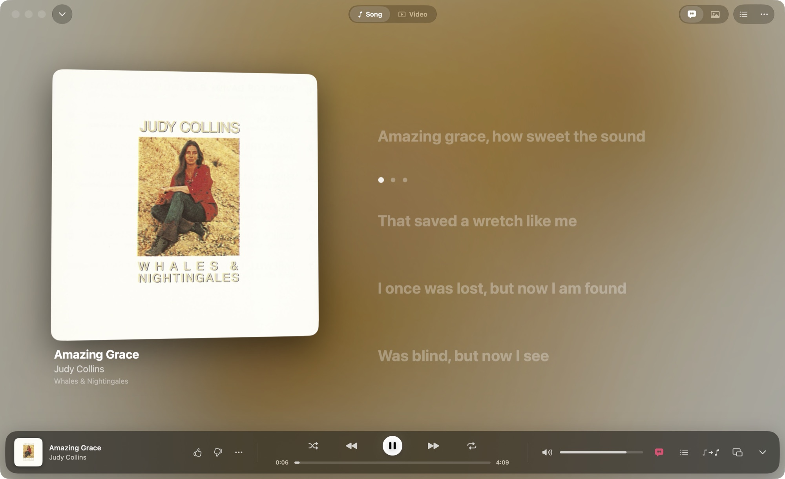
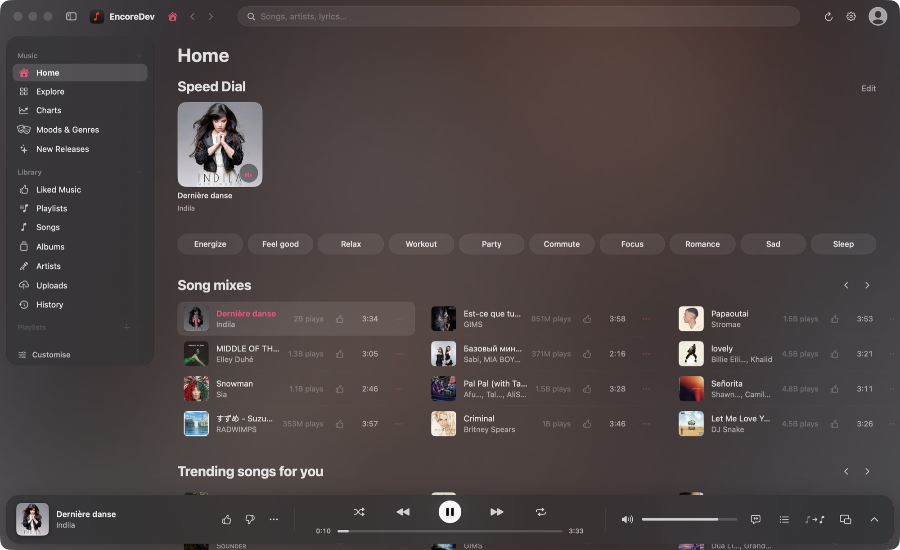
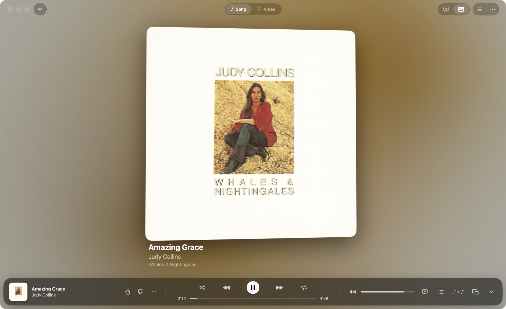
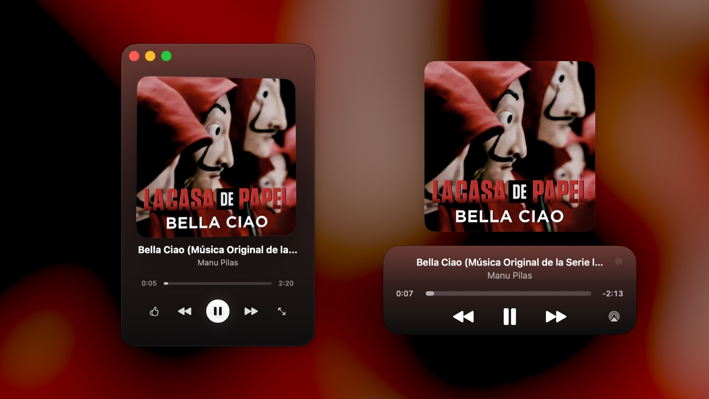

# Encore

**A native macOS client for YouTube Music.** It has an Apple Music–style interface, Liquid Glass, karaoke-style synced lyrics, a lock screen player, desktop widgets and full macOS media integration.

> **Unofficial.** Encore is an independent open-source project. It is not affiliated with, endorsed by or sponsored by Google, YouTube or Apple. "YouTube" and "YouTube Music" are trademarks of Google LLC. You need your own YouTube Music account; Premium is respected (ad-free, higher-quality audio).



| Home | Artwork view |
| --- | --- |
|  |  |

| Mini player and lock screen player | Search |
| --- | --- |
|  |  |

| Artist | Album |
| --- | --- |
|  |  |


<sub>Screenshots were taken signed out, with sample content. Artwork and artist names belong to their respective owners. The lyrics shown are from a public-domain hymn.</sub>

## Features

### Browsing and library

- **Native SwiftUI app.** A sidebar; artwork grids; album, playlist and artist pages; and a rich search page with live suggestions and filters (Songs, Videos, Albums, Artists, Playlists, Podcasts).
- **Home.** Sections you can hide, mood chips, and a Speed Dial of your pinned items plus recently played songs.
- **Endless Home and Explore.** After YouTube's own sections run out, Encore keeps adding "Because you listened to…" sections. Pull down at the top to refresh.
- **Your library.** Liked Music, playlists, songs, albums, artists and history.
- **Uploads.** Your uploaded songs, albums and artists appear in the Library. Add more by dropping audio files on the page or choosing Upload Music (MP3, M4A, FLAC, OGG, WMA).

### Now Playing

- **Full-window player** with an artwork-coloured animated background that reacts to your cursor, Song/Video switching (HD video), and Up Next. Two views, switched with the icons at the top:
  - **Lyrics:** the cover beside the lyrics, or beside Up Next when a song has none.
  - **Artwork:** just the cover, big and slowly breathing. It's animated by Core Animation, so it costs almost no CPU, and you can turn the motion off.
- **Synced lyrics that follow the singer.** Word-by-word karaoke timed to the recording, so the highlight waits through pauses and holds on long notes. Each syllable fills with a soft edge, letters rise as they're sung, a soft glow follows the voice, and sparkles drift off held notes. Word timings come from Better Lyrics, KuGou or NetEase Cloud Music; songs timed only line by line light a whole line at a time (from Better Lyrics or LRCLIB), and YouTube Music's own lyrics are the last resort. Highlight style, alignment, size, glow, rise, sparkles and blur are all adjustable.

### Playback

- **Queue.** Reorder, remove, shuffle, repeat and autoplay ("radio"), plus a play history. Repeat-one loops without a gap.
- **Crossfade.** The next song starts on a second player and plays over the end of the current one, from Off to 12 seconds.
  - A Smart mode plays albums straight through.
  - Repeat-one loops in place with a short volume dip instead (no handover, so it never stalls).
  - The second player only exists for a song's last 40 seconds.
- **Sleep timer and playback speed.**

### Everywhere on your Mac

- **Lock screen player.** While music plays, an iPhone-style card sits on the lock screen:
  - cover, song, progress and controls on tinted Liquid Glass in the cover's colours
  - an **AirPlay output picker** for switching speakers and headphones
  - click the cover to fill the screen with the art; click again to go back

  You can turn it off.
- **Mini player.** A floating glass window that takes on the cover's colours. Toggle it from the player bar or the View menu. ⌘W closes it and ⌘M minimises it.
- **Menu bar player.** A rounded glass dropdown with the cover, controls and progress, tinted by the artwork.
- **Desktop widgets:**
  - Now Playing (small, medium and large), with cover colours, live progress, play controls and Up Next
  - Cover, which shows just the artwork
- **System integration.** Media keys, Now Playing in Control Center, AirPods controls, and a Dock menu. Clicking the Dock icon always brings the window back.
- **Window sizing and tiling.** The layout adapts from full screen down to a half-screen tile; the player bar rearranges itself instead of cutting off controls.

### Look and feel

- **Appearance.**
  - Light or dark mode, with any accent colour (or a preset from popular apps).
  - Panels in Liquid Glass, Frosted or Solid, with adjustable transparency.
- **Sidebar and player bar style.** With Liquid Glass, choose **Frosted** (a soft blur, the default) or **Liquid Glass** (clear and see-through).
- **Smart empty background.** When nothing is playing, the background is built from your accent colour: a soft tint in light mode and a deep one in dark mode, so it suits whatever colour you pick.
- **Layout.** A resizable, reorderable sidebar and rebindable keyboard shortcuts.
- **App icon.** Choose Note, Cut-out or Wave in Settings › Appearance, in glass styles: Dark, Light, Clear (fully see-through Liquid Glass), Graphite or Red. **Automatic** (the default) matches macOS: light or dark mode, and the icon style in System Settings › Appearance (Default, Dark, Clear or Tinted, in your accent colour). The Dock shows your choice while the app is open.

### Updates

- **In-app updates.** Check for Updates is in the app menu, in About and in Settings › General.
- **How installing works.** A progress window shows the download. The update is checked against the release signing key, replaces the old version (which goes to the Trash) and reopens, keeping any name you gave the app.
- **Automatic updates.** Checks and installs are on by default. Installs can happen right away, after a day or a week, or once every 2–3 versions. You can change or turn this off in Settings.

### Extensions

- **Your own extensions.** Small JavaScript files that react to songs and control the player, for example to skip short tracks, post songs to a webhook, or lower the volume at night. They run in their own engine with a limited API. Add, import, edit and switch them in Settings › Extensions.
- **Built-in extensions:**
  - SponsorBlock skips non-music sections of music videos.
  - Auto-skip skips songs you've disliked.

## Requirements

- A Mac with **Apple Silicon** (M1 or later)
- **macOS 14 Sonoma or later.** The Liquid Glass look needs macOS 26; earlier versions fall back to frosted glass.
- A YouTube Music (Google) account

## Install

1. Download the latest `Encore-x.y.z-macOS-arm64.zip` from [Releases](../../releases) and unzip it.
2. Move **Encore.app** to your Applications folder.
3. The app isn't notarised by Apple yet. The first time you open it, **right-click → Open**, or run `xattr -dr com.apple.quarantine /Applications/Encore.app`.
4. Click **Sign In** and sign in on Google's own page.

After that, Encore updates itself (version 1.0.19 and later).

## Build from source

You need Xcode 16 or later (Xcode 26 for the Liquid Glass APIs), or the matching Swift toolchain.

```bash
git clone <this repository>
cd encore
./build.sh --run        # builds build/Encore.app and opens it
./build.sh --install    # copies it to /Applications
```

| Command | Result |
| --- | --- |
| `APP_NAME="Something Else" ./build.sh` | Builds under a different app name. |
| `scripts/package.sh` | Builds a release zip in `dist/`, and signs it if the release key is present. |

You can also open `Package.swift` in Xcode. The package has three targets: the app, the widget extension (`EncoreWidgets`) and the update helper (`EncoreUpdater`).

## How it works

| Part | What it does |
| --- | --- |
| Interface | SwiftUI. The karaoke lyrics, the breathing artwork and the moving backgrounds are drawn with Core Animation, so they stay cheap. |
| Library and search | YouTube Music's InnerTube JSON API (`Core/InnerTube.swift`, `Core/Parser.swift`), authenticated with your signed-in session. The parser skips anything it doesn't recognise, so a change on Google's side breaks one section, not the app. |
| Playback | A hidden `WKWebView` runs music.youtube.com, and Encore drives YouTube's own player (`Core/WebBridge.swift`). Stream deciphering, Premium quality and DRM stay in Google's code. |
| Lyrics | Word-timed lyrics from Better Lyrics (TTML), KuGou (KRC) and NetEase Cloud Music (YRC), asked at once; then line-timed Better Lyrics or LRCLIB; then YouTube Music (`Core/Lyrics.swift`, `Core/WordLyrics.swift`). |
| Lock screen | A non-activating panel placed above the lock screen (`UI/LockScreenArt.swift`). |
| Widgets | A WidgetKit extension that reads what's playing from a shared folder (`Sources/EncoreWidgets`). |
| Updates | The app downloads the release; a small helper (`Sources/EncoreUpdater`) verifies its signature and swaps it in. |

See [docs/ARCHITECTURE.md](docs/ARCHITECTURE.md) for more.

## Privacy and security

- **Sign-in.** You sign in on Google's own page, and **Encore never sees or stores your password.** The sign-in window only loads secure (HTTPS) pages.
- **Sandbox.** The app runs in the **App Sandbox** with the **hardened runtime**, and may only make outgoing network connections. Your session cookies stay in the app's private container.
- **Locked-down web views.**
  - The player and sign-in views only open Google and YouTube addresses, matched exactly (a look-alike domain doesn't pass).
  - The player only accepts messages from music.youtube.com's own page.
- **Signed updates.** Each release zip is signed with an Ed25519 key. The updater refuses any download whose signature doesn't match, or that isn't Encore.
- **Sign Out** wipes all cookies, website data and the saved queue.
- **No tracking.** There's no analytics or telemetry. Third-party services see only what they need:
  - **Lyrics lookups** send the song title, artist, album and length.
  - **SponsorBlock** receives only the first 4 characters of a hash of the video ID.
  - **Update checks** read the public releases feed on GitHub.

## Limitations

- Encore is unofficial, so a change to music.youtube.com can break something until it's updated.
- There are no offline downloads: YouTube restricts downloads to its own apps.
- There's no built-in equaliser, because Apple's web engine doesn't let apps process YouTube's audio stream. A system-wide equaliser app still works.
- The lock screen player uses a private macOS API, so a future macOS version could stop it from appearing. If that happens, the rest of the app keeps working.
- **macOS and Apple Silicon only, for now.** See [Roadmap](#roadmap).

## Roadmap

- Developer ID signing and notarisation, so the app opens without a warning
- An Intel / Universal build
- **Windows and Linux.** The app is built on SwiftUI, AppKit and WebKit, which only exist on Apple platforms, so other platforms need a separate front end. The plan is a cross-platform app (for example Tauri), reusing the same design and the same InnerTube and lyrics logic.

## Credits

- Lyric timing behaviour is modelled on Better Lyrics and [ytm-rs](https://github.com/grapedjuice/ytm-rs). It was reimplemented from scratch, and no code was copied.
- Lyrics data comes from Better Lyrics, [LRCLIB](https://lrclib.net), KuGou and NetEase Cloud Music.
- Segment data comes from [SponsorBlock](https://sponsor.ajay.app).

## License

[MIT](LICENSE)
