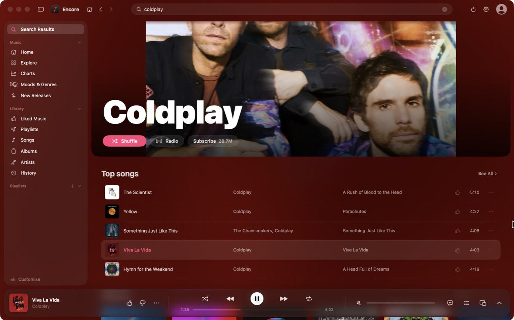
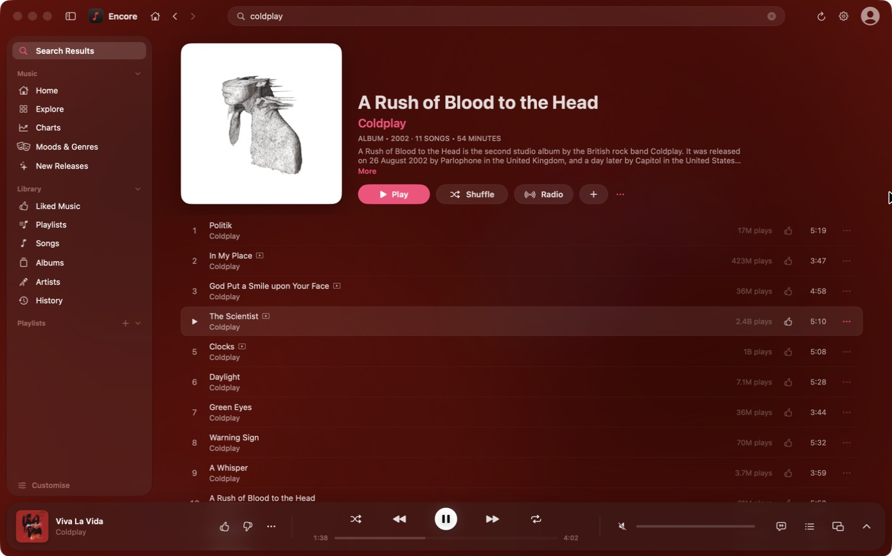
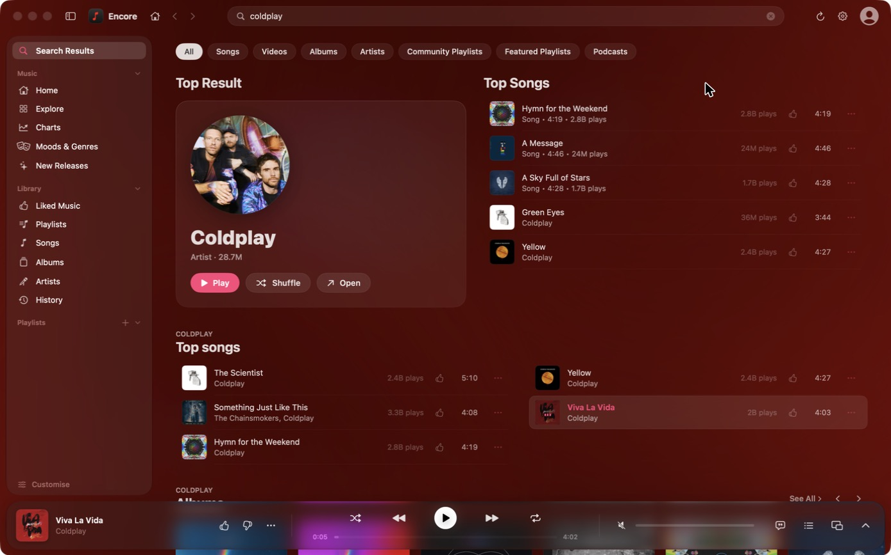
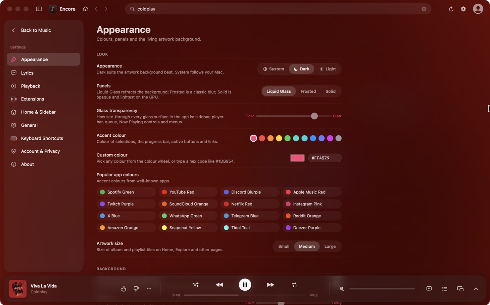

# Encore

**A native macOS client for YouTube Music**, with an Apple Music–style interface, Liquid Glass, karaoke-style synced lyrics and full macOS media integration.

> **Unofficial.** Encore is an independent open-source project. It is not affiliated with, endorsed by or sponsored by Google, YouTube or Apple. "YouTube" and "YouTube Music" are trademarks of Google LLC. You need your own YouTube Music account; Premium is respected (ad-free, higher-quality audio).


| Artist | Album |
| --- | --- |
|  |  |

| Search | Settings |
| --- | --- |
|  |  |

<sub>Screenshots were taken signed out with sample content. Artwork and artist names belong to their respective owners.</sub>

## Features

- **Native SwiftUI app.** Sidebar, artwork grids, album, playlist and artist pages, a rich search page with live suggestions, Home sections you can hide, and a Speed Dial of your pinned items plus recently played songs.
- **Now Playing.** Full-window player with an artwork-coloured animated background that reacts to your cursor, Song/Video switching (HD video), and an Up Next list.
- **Synced lyrics.** Word-by-word karaoke highlighting, using Better Lyrics word timings, LRCLIB line timings, or YouTube Music's own lyrics.
- **Queue.** Reorder, remove, shuffle, repeat and autoplay ("radio"), plus a play history.
- **macOS integration.** Media keys, Now Playing and Control Center, AirPods controls, a Dock menu, a menu bar player, a floating mini player, a sleep timer and playback speed.
- **Customisation.**
  - Light/dark appearance, any accent colour, and a Liquid Glass / Frosted / Solid look with adjustable transparency.
  - A resizable, reorderable sidebar.
  - Rebindable keyboard shortcuts.
- **Built-in extensions.**
  - SponsorBlock skips non-music sections of music videos.
  - An 8-band equaliser with presets.
  - Auto-skip for songs you've disliked.

## Requirements

- A Mac with **Apple Silicon** (M1 or later)
- **macOS 14 Sonoma or later.** The Liquid Glass look needs macOS 26; earlier versions fall back to frosted glass.
- A YouTube Music (Google) account

## Install

1. Download the latest `Encore-x.y.z-macOS-arm64.zip` from [Releases](../../releases) and unzip it.
2. Move **Encore.app** to your Applications folder.
3. The app isn't notarised by Apple yet, so the first time, **right-click → Open** (or run `xattr -dr com.apple.quarantine /Applications/Encore.app`).
4. Click **Sign In** and sign in on Google's own page.

## Build from source

You need Xcode 16 or later (Xcode 26 for the Liquid Glass APIs) or the matching Swift toolchain.

```bash
git clone <this repository>
cd encore
./build.sh --run        # builds build/Encore.app and opens it
./build.sh --install    # copies it to /Applications
```

| Command | Result |
| --- | --- |
| `APP_NAME="Something Else" ./build.sh` | Builds under a different app name. |
| `scripts/package.sh` | Builds a release zip in `dist/`. |

You can also open `Package.swift` in Xcode.

## How it works

| Part | What it does |
| --- | --- |
| Interface | SwiftUI. The karaoke lyrics are drawn with Core Animation (`UI/KaraokeLayer.swift`). |
| Library and search | YouTube Music's InnerTube JSON API (`Core/InnerTube.swift`, `Core/Parser.swift`), authenticated with your signed-in session. The parser skips anything it doesn't recognise, so a change on Google's side breaks one section, not the app. |
| Playback | A hidden `WKWebView` runs music.youtube.com, and Encore drives YouTube's own player (`Core/WebBridge.swift`). Stream deciphering, Premium quality and DRM stay in Google's code. |
| Lyrics | Better Lyrics (word-synced TTML), then LRCLIB, then YouTube Music (`Core/Lyrics.swift`). |

See [docs/ARCHITECTURE.md](docs/ARCHITECTURE.md) for more.

## Privacy and security

- You sign in on Google's own page. **Encore never sees or stores your password.**
- It runs in the **App Sandbox** with the **hardened runtime**, and may only make outgoing network connections. Your session cookies stay in the app's private container.
- All traffic is HTTPS. The player and sign-in views block non-HTTPS and non-Google pages.
- **Sign Out** wipes all cookies, website data and the saved queue.
- There's no analytics or telemetry. Third-party services see only what they need:
  - **Lyrics lookups** send the song title, artist, album and length.
  - **SponsorBlock** receives only the first 4 characters of a hash of the video ID.

## Limitations

- Encore is unofficial, so a change to music.youtube.com can break something until it's updated.
- There are no offline downloads: YouTube restricts downloads to its own apps.
- **macOS and Apple Silicon only, for now.** See [Roadmap](#roadmap).

## Roadmap

- Developer ID signing and notarisation, so the app opens without a warning
- An Intel / Universal build
- **Windows and Linux.** The app is built on SwiftUI, AppKit and WebKit, which only exist on Apple platforms, so other platforms need a separate front end. The plan is a cross-platform app (for example Tauri), reusing the same design and the same InnerTube and lyrics logic.

## Credits

- Lyric timing behaviour is modelled on Better Lyrics and [ytm-rs](https://github.com/grapedjuice/ytm-rs). It was reimplemented from scratch, and no code was copied.
- Lyrics data comes from Better Lyrics and [LRCLIB](https://lrclib.net).
- Segment data comes from [SponsorBlock](https://sponsor.ajay.app).

## License

[MIT](LICENSE)
